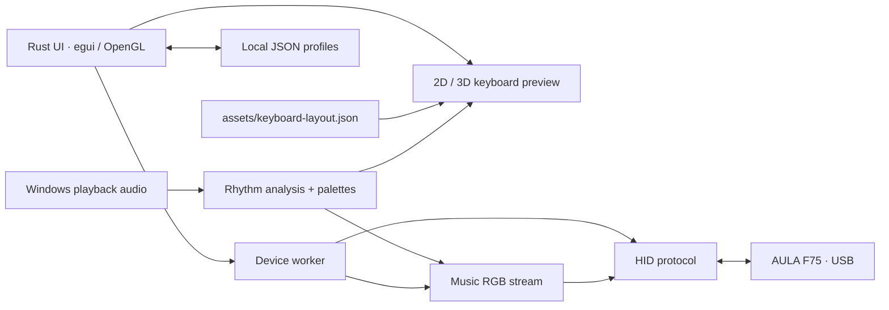

# Aula Studio

A lightweight Rust app for controlling the **AULA F75 keyboard over USB** on Windows.

- Lighting, key remapping, macros and profiles.
- Music-reactive lighting with 20 color palettes.
- 2D and 3D keyboard previews.

Tested on Windows 11 with an ISO/French F75. Wireless configuration is unsupported. This is an independent project, not an official AULA app.

## Build and run

Install [Rust](https://www.rust-lang.org/tools/install) with the MSVC toolchain and **Visual Studio Build Tools** with **Desktop development with C++** and a Windows SDK.

Open PowerShell in this folder:

```powershell
.\BUILD.ps1 release
.\target\release\aula-studio.exe
```

The first build downloads the pinned Rust toolchain and dependencies. Both the app and the `f75-check.exe` recovery utility are created in `target/release/`.

Connect the keyboard in USB mode and close other keyboard software. Use **Apply** to save changes. For music lighting, play audio, open **Music**, choose a palette and select **Start music sync**. Stop music sync before unplugging the keyboard.

## How it works



`src/` contains the app and tests; `assets/` holds the keyboard layout. Cargo files, `.cargo/`, `rust-toolchain.toml` and `BUILD.ps1` control the build. `licenses/` contains third-party notices.

## License

[MIT](LICENSE). When sharing compiled executables, include `LICENSE`, [THIRD_PARTY_NOTICES.md](THIRD_PARTY_NOTICES.md) and the [licenses](licenses/) folder.
